# 開発の流れ

かたみ帳 を、ハッカソンの期間（11/2〜11/8）にどう作ったかをまとめます。機能の一覧とセットアップは [README.md](../README.md) にあります。

## 1. 期間中の開発の流れ

```mermaid
flowchart LR
  d1["11/02<br>参加と進め方を決める<br>仕様を決める役と<br>作る役を分ける"]
  d2["11/03<br>デモ動画の作り方を<br>小さく作って比べる"]
  d3["11/04<br>問いに答えて土台を固める<br>目的は画像解析でなく<br>家族の見直し"]
  d4["11/04<br>AI が大切な物を当てる<br>方向は採らない"]
  d5["11/05<br>撮るのは誰でも<br>決めるのは家族"]
  d6["11/05<br>待ったを中心にする<br>アプリを動画より先に"]
  d7["11/06<br>仕様 v1 から計画 v2 へ<br>段ボール1箱・手がかり順<br>確からしさはコード"]
  d8["11/06〜11/07 未明<br>本体を実装<br>AI 担当と画面担当を<br>契約で分けて並行"]
  d9["11/08 未明<br>React 版の画面を<br>別ブランチで並行に作る"]
  d10["11/08 昼<br>読み取りを Sonnet へ<br>背景の見落としの知らせ"]
  d11["11/08 夕<br>記憶係<br>Managed Agents のメモリ"]
  d12["11/08 夕<br>スマホでの指摘と<br>UI の総点検を直す"]
  d13["11/08 夕<br>公開前の点検<br>費用と露出の穴を直す"]
  d1 --> d2 --> d3 --> d4 --> d5 --> d6 --> d7 --> d8 --> d9 --> d10 --> d11 --> d12 --> d13
```

| 日 | 考えたこと・決めたこと | 作ったもの |
|---|---|---|
| 11/02 | 個人で参加。仕様を決める役と、指示書どおりに作る役を分ける | リポジトリの構成、日程 |
| 11/03 | デモ動画は、絵コンテ → 音声 → 秒数 → 動画の順に作る | 動画を作る仕組みの小さな試し（複数の道具を比べた） |
| 11/04 | 汎用の画像解析ではなく、家族の見直しと記録を目的にする。AI に大切さを当てさせない | 問題文（仮） |
| 11/05 | 撮る人と決める人を分ける。「待った」を中心に、アプリを動画より先に作る | 作品のアイデア（仮） |
| 11/06 | 静止画、モノカード、人物カード、一覧の待った、見本に絞る | 仕様 v1、実装の計画 v2 |
| 11/06〜11/07 未明 | 計画 v2 のとおり作る | 撮影、読み取り、一覧、待った、人物、見本（API と最初の画面） |
| 11/08 | 画面を作り直し、読み取りを広げ、公開前に点検する | React 版の画面、背景の見落としの知らせ、記憶係、スマホと UI の修正、守りのヘッダと費用の歯止め |

## 2. Claude をどう使ったか

### 作品の中で

| 場面 | モデル | 役割 |
|---|---|---|
| 写真の読み取り（4 回、並列） | `claude-sonnet-5-5` | A 文字読み、A2 人名・日付・数字の再読（A を見せない）、B 物の観察、C 対象と背景 |
| 人物の仮説の更新 | `claude-sonnet-5-5` | 5 枚ごとか 60 秒ごとに、物から見えてきた人を札にまとめる |
| 箱ぜんたいの知らせ | `claude-opus-5-5` | 写真をまたぐつながりを、文だけで 1 箱に 1 回判定する。記憶係が無いときの経路 |
| 記憶係 | `claude-opus-5-5` | Managed Agents のエージェント。片付け 1 つにメモリストア 1 つを持ち、日や箱をまたいで背景の手がかりを覚えて知らせる |

- Claude は観察だけを返し、「大切です」「捨ててよい」とは言いません
- 順位、確からしさ、知らせの根拠の検査はコードで行います。知らせは、根拠の文が物の読み取りに無ければ外します
- 写真の中の文字は読む対象で、命令として扱いません

詳しくは [src/README.md](../src/README.md) と [src/CONTRACT.md](../src/CONTRACT.md) にあります。

### 作るときに（Claude Code）

- **仕様を決める役と、作る役を分けた**：仕様と実装の指示書を先に書き、作る側は指示書と仕様だけを読んで作り、仕様を変えません。仕様と指示書は、別のモデルにも読ませて直しました
- **担当を契約で分けて並行に作った**：AI 担当（`src/ai/`）と画面担当（`src/routes/`、`public/`）の境目を [src/CONTRACT.md](../src/CONTRACT.md) に決めました。共有ファイルは触らない、型は自分の側に置く、マイグレーションの番号を担当ごとに分ける、という決まりで、同じファイルを触らずに進めました
- **画面は別ブランチで作り直した**：今の画面を残したまま、React 版を別のブランチで並行に作り、API を変えずに取り込みました
- **自動で試験した**：Playwright で、スマホの大きさのブラウザで画面を動かして試します。Claude は置き換えのサーバにして、料金をかけません。順位や人物の計算は単体の試験で、読み取りは実物の写真で確かめました
- **画面の決まりを作って点検した**：文字は 3 段階、角丸は 3 種類、箱の入れ子なし、強い色は待っただけ、などを [src/web/README.md](../src/web/README.md) に決め、総点検で見つかった操作性の問題を直しました
- **公開前に点検した**：費用と露出の点から見直し、Claude を呼びすぎない仕組み、エラー文を返さないこと、写真の大きさの確認、守りのヘッダを足しました

## 3. 主な決定と理由

| 決定 | 理由 |
|---|---|
| AI は大切かどうかを判断しない。観察だけを返す | 「本人にとって大切か」に正解は無く、AI が人より早く当てられる根拠もない。目指すのは、判断の過程が見えて、あとから見直せること |
| 売りは「その場にいない家族にも、待ったを渡す」 | 中身を見る人がその場にいない理由は、遠い・忙しい・体力がない・疎遠など、ふつうにある |
| 1 人でも待ったを押せば残す。承認・保留などの区分は作らない | 区分が増えると操作が増え、「待った」と結びつきにくい |
| 順位と確からしさはコードで計算する | 同じ入力に同じ結果を出し、理由を説明できるようにするため |
| 確からしさは、本人申告・A と A2 の一致・画像の上限の小さい方 | 同じモデルの再読なので、「確認済み」とは言わない |
| 読み取りを Opus から Sonnet に替えた | 実物の写真 17 枚で試し、見落としの知らせは Sonnet でも足りると判断した |
| 記憶係は、無くても動くようにする | 設定が無いときや失敗したときは、1 回の呼び出しで箱の知らせを作る |
| ログイン画面を持たず、人ごとの招待リンクで入る | 試しやすさのため。家族の写真と名前を扱うので、本番ではログインを必須にする |
| 写真はリポジトリの外に置き、公開 URL を持たせない | 写真は参加者だけに返す |
| 1 日の上限と、Claude の呼び出しを止めるスイッチを置く | 料金の暴走を止めるため |
| 動画からの読み取り、現場の音声、業者が撮る形などは作らない | 期間内に、撮る → 見直す → 待ったの流れを確かに動かすため |
